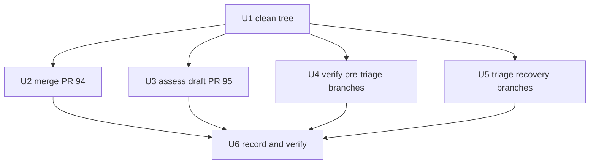

# Branch and PR consolidation to main - Plan

## Goal Capsule

- **Objective:** Land every still-useful old branch and open PR into `main`, then leave zero unmerged remote branches without losing unique work.
- **Authority:** User request (consolidate all old branches and PRs to `main`); repo conventions from `AGENTS.md`; land/archive precedent in `docs/branch-triage-20260906.md`.
- **Stop conditions:** `git branch -r --no-merged origin/main` shows only `main` (plus `HEAD`) and, while PR #95 stays draft, its source branch `cursor/execution-foundation-dda0`; open PR count is zero or only DRAFT #95 with a written verdict; `main` CI is green; the triage record cites a `main`-side ref for every hunk classified already-on-main.
- **Execution profile:** Git operations plus review fixes. No product behavior changes except what the landed PRs themselves carry.
- **Tail ownership:** LFG pipeline owns merge, review, PR, and CI-watch.

## Product Contract

### Summary

Nine remote branches never merged into `main` and two PRs never landed. Four branches predate the 2026-09-06 triage and look superseded. Five `recovery/20260911/*` branches are salvage snapshots whose unique content is unverified. PR #94 is mergeable but CI-unstable. PR #95 is a same-day draft. The working tree on `main` is dirty.

### Problem Frame

Stale branches hide work that may still matter and confuse every future triage. Open PRs with unstable CI block the merge queue. The consolidation must land what is useful, archive-tag what is not, and prove each decision with content diffs rather than assumptions.

### Requirements

**PR consolidation**

- R1. PR #94 (`fix/product-mcp-deploy-gate-20260912`) merges into `main` only with exact-head green CI and no unrelated changes.
- R2. DRAFT PR #95 (`cursor/execution-foundation-dda0`) is assessed and left unmerged while draft; its merge-readiness verdict is recorded.

**Branch cleanup**

- R3. Each of the four pre-triage branches is content-verified against current `main`; confirmed-superseded branches get an archive tag and remote delete.
- R4. Each of the five `recovery/20260911/*` branches is diff-triaged; unique useful content lands through a reviewed PR, the rest gets an archive tag and remote delete.

**Safety and evidence**

- R5. No force-push to `main`, no branch delete without a prior archive tag and a triage record citing diff-stat plus `main`-side refs, no merge of a red-CI head.
- R6. The dirty working tree is preserved on a work branch before any other unit runs.
- R7. A triage record documents every branch disposition with its evidence.

### Scope Boundaries

- Closed historical PRs stay closed; only their still-open source branches fall under R3.
- Dependabot branches are out of scope unless found open during execution.
- `Deferred to Follow-Up Work`: re-running the full pytest suite per recovery-branch PR beyond the focused checks in U5 is deferred to CI itself.

### Dependencies

- `gh` CLI authenticated with push and merge rights; CI runners available.
- Origin state below was read 2026-09-12 against `main` at `55b5b17`.

### Sources

- `docs/branch-triage-20260906.md` (land/archive model, archive-tag discipline).
- Live inventory: `git branch -r`, `gh pr list --state all`, per-branch `git rev-list --left-right --count`.

## Planning Contract

- KTD1. Merge through `gh pr merge --merge`. The repo history lands PRs as merge commits (per #81). Squash would rewrite contributor history against convention.
- KTD2. Delete a remote branch only after its tip has an `archive/20260912/<slug>` tag and its content verdict is written down. Follows the 09-06 precedent and keeps every delete reversible.
- KTD3. Keep DRAFT #95 unmerged. Draft status means the author has not released it; merging it would bypass author intent.
- KTD4. Land recovery-branch content only via fresh PR with exact-head CI, never by direct push to `main`. Salvage snapshots are unverified by definition.
- KTD5. Stabilize the dirty tree first. Units U2-U6 assume a clean tree; mixing uncommitted `main` edits into merge work would corrupt attribution.

### Assumptions

- Merge method `--merge` is acceptable to the repo (matches history).
- Archive tag namespace `archive/20260912/<slug>` is free.
- PR #94 head state (verified 2026-09-12): all repo CI checks pass, the only failure is the third-party CodeFactor gate, and `main` has no branch protection. U2 treats repo-checks-green as the merge bar and CodeFactor as advisory.
- The two dirty tracked files are keep-worthy state (small acked eval/signal updates), verified by diff inspection in U1 step 1 against the keep-versus-regenerable rule.

### Sequencing

## Implementation Units

### U1. Preserve the dirty working tree

- **Goal:** `main` checkout is clean; uncommitted work survives on a named branch.
- **Requirements:** R6.
- **Dependencies:** None.
- **Files:** `.agents/eval/scorecard.json`, `.agents/registry/signals.yaml` (move, not edit); new branch `chore/worktree-20260912`. Untracked runtime state (`.cursor/hooks/state/`) is never committed. Untracked work product (this plan, session logs) stays in place for the pipeline to commit later.
- **Approach:**
  1. Inspect the diff of both tracked files. Keep-worthy means acked human or eval state that cannot be regenerated; regenerable output is discarded, not branched.
  2. Create the work branch from current `main` and commit the kept files there.
  3. Restore a tracked-clean `main` checkout.
- **Test scenarios:**
  1. `git status --porcelain --untracked-files=no` on `main` returns empty after the move.
  2. The work branch diff against `main` contains exactly the kept files.
- **Verification:** Clean tree on `main`; work branch pushed to origin.

### U2. Land PR #94 with green exact-head CI

- **Goal:** `fix(product-mcp-deploy-gate-20260912)` merged; nothing else rides along.
- **Requirements:** R1, R5.
- **Dependencies:** U1.
- **Files:** Whatever the PR head touches (no new files planned); merge only.
- **Approach:**
  1. List required versus reported checks for #94 and confirm each required check ran on the exact head.
  2. Fix failing repo checks on the PR branch; CodeFactor alone failing does not block (advisory, per Assumptions).
  3. Re-run the repo gate (`ruff`, `mypy`, focused tests) on the exact head.
  4. Merge with `--merge` once all repo-required checks are green.
- **Test scenarios:**
  1. `gh pr checks 94` shows all required checks green on the merged head.
  2. `main` still passes the repo gate after the merge.
- **Verification:** PR #94 state is `MERGED`; merge commit on `main`.

### U3. Assess DRAFT PR #95 and record the verdict

- **Goal:** A written merge-readiness verdict for the execution-foundation draft; no merge while draft.
- **Requirements:** R2, R5.
- **Dependencies:** U1.
- **Files:** None (assessment only).
- **Approach:**
  1. Review scope, size, and CI state of `cursor/execution-foundation-dda0`.
  2. Record verdict (ready-to-undraft, needs-work with reasons, or out-of-scope) in the U6 triage record.
  3. If trivially merge-ready and author intent is clear, convert to ready only with explicit user approval; default is leave as draft.
- **Test scenarios:**
  1. Verdict names the blocking checks or reviews, if any.
  2. PR #95 is still `OPEN` and `DRAFT` unless approval to undraft was given.
- **Verification:** Verdict present in the triage record; no unapproved state change.

### U4. Verify and archive the four pre-triage branches

- **Goal:** The four branches are content-verified against current `main`; proven-superseded branches are tagged and deleted, and any branch with content missing from `main` is routed to the U5 landing path.
- **Requirements:** R3, R5.
- **Dependencies:** U1.
- **Files:** None (git metadata plus the U6 record).
- **Approach:** For each branch, diff its unique commits against current `main` and record per-branch diff refs first. Hypothesis (from the 09-06 triage, which landed this content via #75, #76, and #78 and closed #79 as superseded): archive-tag plus remote delete. Select archive-delete versus U5-landing on the fresh evidence, with the prior triage as context, not verdict.
- **Test scenarios:**
  1. Each branch tip has an `archive/20260912/<slug>` tag pointing at the pre-delete tip.
  2. `git branch -r` no longer lists the branch after delete.
  3. Focused dashboard/docs checks still pass on `main`.
- **Verification:** Four tags exist; four branches gone; exceptions documented.

### U5. Triage the five recovery snapshots

- **Goal:** Unique useful content from `recovery/20260911/*` lands via reviewed PRs; the rest is archived.
- **Requirements:** R4, R5.
- **Dependencies:** U1.
- **Files:** Per-branch diff decides; landing PRs touch only the files carrying unique content.
- **Approach:** For `connections-plugin-manifests-4e2a0802`, `kater-studio-salvage-20260831-6bde8d86`, `pr59-truthful-ui-47f520-468cf03f`, `repo-971f231f`, and `studio-postmerge-eval-20260901-c226ca19`:
  1. Produce diff-stat against `main` and classify each hunk as already-on-main, superseded, or unique-useful.
  2. Cherry-pick unique-useful hunks onto a fresh landing branch per topic and open a PR with exact-head CI.
  3. Archive-tag and remote-delete the source branch once its disposition is final. Landing zero hunks is a successful outcome when no hunk meets the unique-and-useful bar; tag-and-delete with evidence is then the correct disposition.
- **Test scenarios:**
  1. Every landed hunk is covered by the landing PR's CI (exact head green).
  2. No landing PR carries `[skip ci]` archive commits or unrelated salvage noise.
  3. Each source tip has an archive tag before delete.
- **Verification:** Landing PRs merged; remaining source branches deleted with tags.

### U6. Write the triage record and prove the end state

- **Goal:** `docs/branch-triage-20260912.md` records every disposition; the repo proves the stop conditions.
- **Requirements:** R7 plus the Goal Capsule stop conditions.
- **Dependencies:** U2, U3, U4, U5.
- **Files:** `docs/branch-triage-20260912.md` (new, follows the 09-06 record shape).
- **Approach:**
  1. Record per-branch and per-PR disposition with evidence (diff refs, check runs, tags).
  2. Verify `git branch -r --no-merged origin/main` is empty apart from `main`.
  3. Verify the repo gate on final `main`.
- **Test scenarios:**
  1. Unmerged-branch listing contains no stale branch.
  2. Open-PR listing contains at most DRAFT #95 with its U3 verdict.
  3. Full gate (`ruff`, `mypy`, `pytest`) passes on final `main`.
- **Verification:** Record committed; listings and gate output captured.

## Verification Contract

| Command | Applies to | Done signal |
|---|---|---|
| `uv run ruff check .` | U2, U4, U5, U6 | Clean |
| `uv run mypy` | U2, U4, U5, U6 | Clean |
| `uv run pytest` | U2, U6 | Pass (~100-120s) |
| `gh pr checks <n>` | U2, U3, U5 | Required checks green on exact head (U5 landing PRs prove themselves through CI) |
| `git branch -r --no-merged origin/main` | U4, U5, U6 | Only `main` remains |
| `gh pr list --state open` | U6 | Zero, or only DRAFT #95 |

## Definition of Done

- Global: all stop conditions from the Goal Capsule hold; no force-push to `main` happened; every deleted branch has an archive tag; the triage record is committed.
- Per unit: each unit's Verification items are met; abandoned approaches leave no stray branches (anything created and rejected gets archived or deleted with a note).
- Cleanup: local tracking branches for deleted remotes are pruned; no leftover landing branches remain open.
